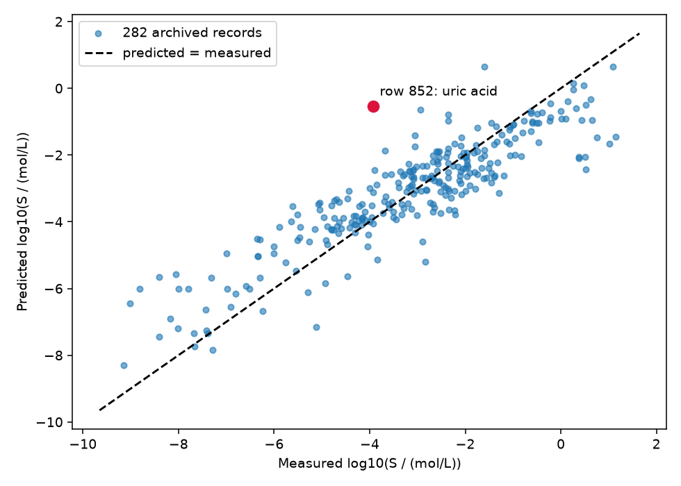

# M01: научный кейс, прогрессия и фактические проверки

**Исторический отчёт первой реализации `abbb186`.** Актуальная развёрнутая редакция, 14 тестов на каждой ОС и новые captures описаны в [CONTEXT_REVISION_REPORT.md](CONTEXT_REVISION_REPORT.md). Численные значения исходного анализа ниже сохраняют силу; прежние запуски не считаются исполнением нового текста.

17.11.2026. Ветка `practice/issue4-research-m01`, основание main `a803d90`. Реализация Issue #4 ограничена M01. Другие 13 модулей, химические эталоны, теория и результаты прежнего аудита не переопределены. Старый синтетический пример 2×2 доступен в истории Git на исходном commit; готовым научным практикумом он не объявляется.

## Что студент исследует и зачем

Можно ли использовать расчёт растворимости для выбора следующего измерения? В [разборе](01_guided_case.ipynb) студент сначала формулирует ожидание, затем читает проверенные реальные наблюдения и готовые прогнозы, рассчитывает ошибки и обнаруживает расхождение, скрытое средним. После проверки шкалы, байтов и недостающих условий он выбирает следующую проверку. Объяснения чередуются с короткими вычислительными шагами; таблицы и графики получены фактическим запуском.

Научная опора — [Delaney (2004)](https://pubmed.ncbi.nlm.nih.gov/15154768/), DOI 10.1021/ci034243x. Используется конкретный вторичный DeepChem snapshot 1128 записей, а не все 2874 измерения, упомянутые в abstract оригинальной статьи. Это сравнение архивных столбцов, не воспроизведение fitting и не независимая validation ESOL. [Паспорт источника](RESEARCH_SOURCE.md) объясняет единицы, версию, права и все учебные преобразования. Первичная проверка источника выполнена в 12:05 UTC, до сборки блокнотов; [preflight](evidence/source-preflight-20261117.json) и [повторная онлайн-проверка](evidence/source-online-20261117.json) сохранены отдельно.

Прогрессия [самостоятельной работы](02_independent_lab.ipynb):

| ID | Исследовательское действие | Связь и помощь | Что нужно защитить |
|---|---|---|---|
| M01-C1 | Перенести знакомый анализ на 282 другие реальные записи | Готов только вход; две раскрываемые подсказки | График, остатки, метрики, локальный риск и границы вывода |
| M01-C2 | Различить причины несоответствия после импорта тех же записей | Результат C1 — контроль; одна подсказка, требуется проверить две гипотезы | Преобразование с единицами, восстановление результата, сохранность исходника |
| M01-C3 | Самостоятельно выбрать следующий метод/эксперимент | Выводы C1/C2 и карточки источников; алгоритма решения нет | Опровержимый вопрос, контроль, измеряемый endpoint, альтернатива и ограничение |

Дефект C2 явно синтетический: авторский экспортер записал линейную концентрацию под заголовком logS. Он не приписывается публикации или DeepChem. Студент может исследовать подлинное численное расхождение и контролируемую неисправность, не смешивая их происхождение.

Контекст курса A — ксантины/истрадефиллин/A2A/CNS; начальное досье B — аторвастатин/HMGCR/печёночная экспозиция. ESOL не превращается в данные по BBB или печени. C3 требует заметить несовпадение endpoint и выбрать соответствующую проверку; новые численные измерения экспозиции не выдумываются. Студент создаёт собственное досье и объяснённое направленное ребро карты; существующие файлы досье сохраняются.

## Фактический результат

| Расчёт | n | MAE, logS | RMSE, logS | Крупнейшее расхождение |
|---|---:|---:|---:|---|
| Guided, row_id mod 4 = 0 | 282 | 0.7690035460992907 | 1.0037640277496775 | row 852, uric acid: ε = +3.389; кратность 2449.063 |
| C1, row_id mod 4 = 1 | 282 | 0.6410035460992908 | 0.8536171742308398 | row 733, alloxantin: ε = +2.909; кратность 810.961 |
| C2: несовместимые шкалы, до восстановления | 282 | 3.121446011361413 | 3.717882052527648 | Диагностический результат ошибочной операции; физического смысла метрики нет |
| C2: после подтверждённого восстановления log10 | 282 | 0.6410035460992908 | 0.8536171742308398 | Совпадает с C1, raw SHA256 неизменен |

MAE меньше единицы не гарантирует приемлемость каждого прогноза. Причина расхождения uric acid не установлена: в snapshot нет pH, температуры, формы образца и индивидуальной погрешности. Кратность — отношение концентраций из двух архивных чисел, не вероятность ошибки, клинический эффект или независимое измерение. Разделение по row_id — учебное распределение строк, не химически независимый train/test.



## Окружения и логи

| Проверка | Windows 10, Python 3.12.10 | Ubuntu 24.04 / WSL2, Python 3.12.3 | Граница доказательства |
|---|---|---|---|
| 11 unit tests | PASS | PASS | Числа, SHA, повреждённый вход, арифметика, сохранность досье, schema/compile/imports |
| Guided, чистое ядро | PASS | PASS | Все вычислительные ячейки исполнены; два фактических PNG встроены в outputs |
| Independent, пустой шаблон | PASS | PASS | 3 кейса остаются NOT_RUN, решения студента отсутствуют |
| Instructor C1/C2 | PASS | PASS | Реальные авторские численные решения; C3 требует научной оценки |
| Наличие RDKit | отсутствует | отсутствует | Отдельные минимальные uv-среды и отдельное ядро |

Обе среды: uv 0.13.8, matplotlib 3.11.2, nbformat 5.11.1, nbclient 0.11.0, ipykernel 7.4.0. Полный состав и вызов ядра — [Windows environment](evidence/windows-20261117/environment.json), [Linux environment](evidence/linux-20261117/environment.json). Python 3.11 допускается resolver, но здесь NOT_RUN; проверена 3.12. Прямые импорты урока — stdlib, matplotlib и IPython display; NumPy установлен как зависимость matplotlib и в учебном коде не требуется.

В каждом каталоге запуска: `run.json` с точным argv/cwd/UTC/exit code, `stdout.txt`, `stderr.txt`; для Notebook также `input.ipynb` и `executed.ipynb`. [Windows summary](evidence/windows-20261117/summary.json), [Linux summary](evidence/linux-20261117/summary.json), [реестр проверок](practice-checks.csv). `inputs.json` фиксирует hash кода, lock, входных Notebook и snapshot. [Манифест артефактов](evidence/artifact-manifest.json) фиксирует публикуемые байты; Git не преобразует окончания строк в этих доказательствах.

Существующая проверка структуры курса и 8 исходных Labs tests также PASS в прежней полной химической среде: [отдельные команды и логи](evidence/baseline-regression/runs.json). Эта среда содержит RDKit и не подменяет минимальную среду M01. Целостность публикуемых доказательств и совпадение учебных ячеек с реально исполненными входами проверяются без ядра командой `python course_source/modules/M01/verify_evidence.py`.

Команды для повторения из корня репозитория (подробности подготовки в [README](README.md#окружение)):

```text
uv sync --project course_source/modules/M01 --frozen --python 3.12
uv run --project course_source/modules/M01 --frozen python course_source/modules/M01/fetch_data.py --from-file Labs/datasets/esol.csv
uv run --project course_source/modules/M01 --frozen python course_source/modules/M01/register_kernel.py
uv run --project course_source/modules/M01 --frozen python course_source/modules/M01/run_checks.py --output tmp/my-m01-evidence
```

Новый output-каталог обязателен; старые доказательства не перезаписываются. Windows/Linux запуски выполнялись вне публикуемого `evidence/`; точные абсолютные пути отражены в логах. Перед публикацией guided взят из фактически исполненной Linux-копии; шаблон independent оставлен без ответов и outputs. Кодовая часть обеих книг соответствует сохранённым input-копиям. `build_notebooks.py` пересоздаёт чистые исходники и очищает outputs: запускать его только при осознанном изменении материала, затем повторять проверку.

Исходный и производные CSV не добавляются повторно в Git. Загрузчик проверяет официальный snapshot; численные решения сохраняют таблицы локально. Производные CSV, созданные при проверке, остаются в локальных каталогах запуска; при повторении они создаются вновь. Публикуются собственные графики, сводки и ограниченные примеры строк. Существующий Labs snapshot не менялся.

## Авторская содержательная и дидактическая проверка

Автор проверил: соответствие вопроса вычисляемой величине; знак/основание логарифма/единицы; отличие наблюдения от прогноза; различие архивной ошибки и независимой validation; отсутствие выдуманного механизма; соответствие графика исходным числам; различие источника и искусственного дефекта; различие растворимости, геометрии комплекса и клеточной экспозиции. Это авторская проверка, не независимая научная рецензия.

Дидактическая проверка по артефактам: у guided есть предварительный прогноз, наблюдаемый конфликт, проверка альтернатив и решение; C1 переносит метод, C2 требует диагностики двух гипотез, C3 выбирает метод и критерий опровержения. Подсказки 2→1→0. [Рубрика преподавателя](instructor/RUBRIC.md) оценивает постановку, метод, диагностику и решение, а не наличие Markdown-ответа. Форматный PASS явно оставляет `scientific_review=NOT_RUN`. Способность реальных учащихся решить новую проблему ещё не измерена.

При авторском просмотре первого технического запуска найден недостаток: backend Agg сохранял PNG, но `plt.show()` не встраивал изображения в notebook. До итогового прогона добавлен явный вывод PNG и runtime-проверка двух изображений. Публикуемые запуски — исправленный вариант; предварительные логи сохранены локально отдельно, результаты вычислений от изменения способа показа не менялись.

## Нерешённые задачи по приоритету

1. **P1 / NOT_RUN:** независимый химический/фармакологический разбор C3 и проверка научной адекватности всего пилота специалистом; затем учебный пилот с целевой аудиторией. Проверить время, непонятные переходы и перенос навыка без подсказок. Наличие кода и авторской рубрики этого не доказывает.
2. **P1 / NOT_RUN:** преподавательская оценка настоящих студенческих выводов/досье/нового ребра карты по рубрике; договориться о пороге принятия и разбирать альтернативные обоснованные решения C3.
3. **P2 / NOT_RUN:** реальная интеграция и проверка Stepik grader. В M01 не утверждается работа Vina, PySCF или итогового проекта: они вне этого пилота и требуют своих доказательств по Issue #1.
4. **P2 / ограничение:** отдельные права на перепубликацию оригинального ACS supplementary не установлены. Проверен MIT LICENSE репозитория DeepChem; выбран путь загрузки официальных байтов без новой полной копии. Для отдельного распространения исходного набора нужна соответствующая проверка прав.
5. **P2 / после оценки пилота:** перенос научного стандарта на оставшиеся 13 модулей и связи A/B по нескольким подлинным исследованиям. Это следующий этап, не результат текущего PR.

Итоговый статус: технические вычисления проверены на двух ОС; учебный материал доступен для содержательного ревью. Образовательная эффективность, независимая научная приёмка и платформенный выпуск остаются NOT_RUN.
