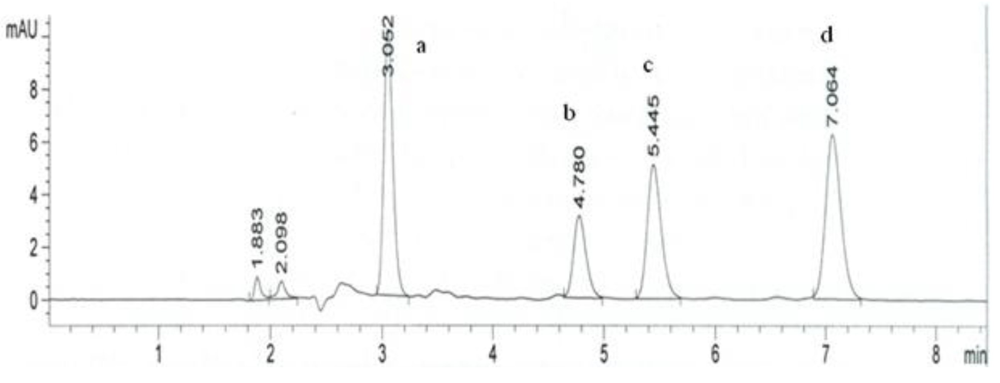

# Исходная хроматограмма из публикации

Milkica Crevar-Sakač, Zorica Vujić, Jasmina Brborić, Vesna Kuntić, Snežana Uskoković-Marković (2013). *An Improved HPLC Method with the Aid of a Chemometric Protocol: Simultaneous Determination of Atorvastatin and Its Metabolites in Plasma*. Figure 5. [DOI 10.3390/molecules18032469](https://doi.org/10.3390/molecules18032469). Лицензия [CC BY 3.0](https://creativecommons.org/licenses/by/3.0/). Изображение сохранено без изменений; точный адрес и SHA256 — в [паспорте](atorvastatin_hplc_figure5.json).

Аннотации a/b/c/d относятся к p-гидроксиформе, o-гидроксиформе, аторвастатину и лактону: 3,052 / 4,780 / 5,445 / 7,064 мин. Условия этой иллюстрации: 61,93% ACN, 31,44 °C, 1,03 мл/мин при остальных условиях методики. Это один опубликованный результат, не полный числовой dataset сигналов.

Картинка позволяет проверить происхождение выбранных аннотаций и единицу времени. По ней не приписываем таблице отсутствующие измеренные базовые ширины. В тренажёре только первое/последнее удерживания моделируются по 20 опытам; перенос средних положений и Gaussian-ширины остаются отдельными учебными допущениями. Неокрашенный исходный рисунок и условный рисунок интерфейса имеют разное происхождение.
